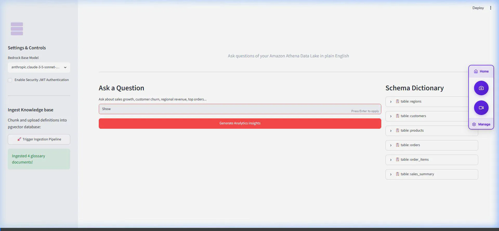
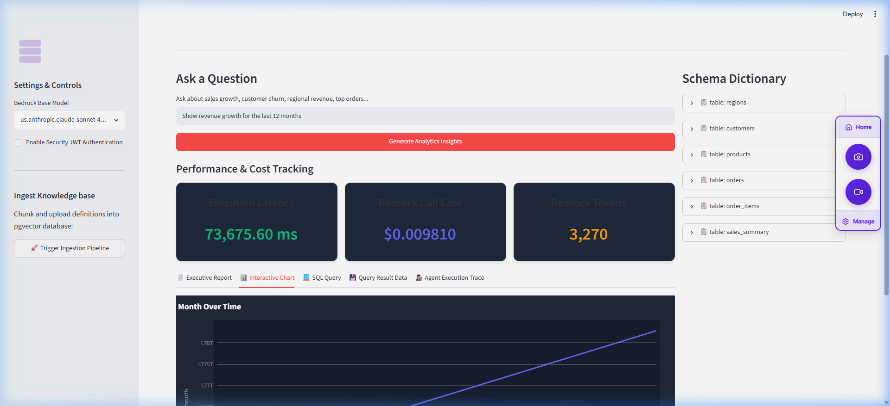
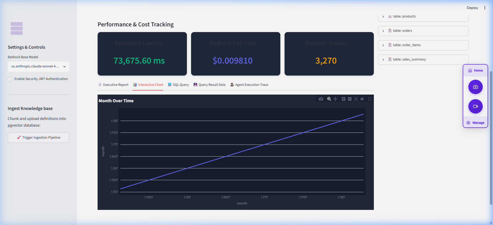

# Enterprise Text-to-SQL Analytics Agent Platform (Week 5 Capstone)

This repository contains a production-ready, enterprise-grade Text-to-SQL Analytics Agent Platform. Business users can ask complex questions in plain English and receive SQL-generated answers, interactive Plotly visualizations, business summaries, and detailed multi-agent telemetry traces.

## System Architecture

The application is structured into a containerized multi-agent system built on **Strands Agents**, **Model Context Protocol (MCP)**, **FastAPI**, **pgvector (Postgres)**, and **Streamlit**.

- **Supervisor Agent**: Orchestrates task routing, intent classification, and compiles responses.
- **RAG Agent**: Queries PostgreSQL vector DB to extract relevant business glossaries, schema specifications, and rules.
- **SQL Generation Agent**: Translates English and schema context into Presto/Athena compatible queries.
- **SQL Review Agent**: Validates queries for safety (only SELECT, no DDL/DML), schema matching, and syntax.
- **Execution Agent**: Runs queries against AWS Athena or a local DuckDB mock parquet layer, with LLM self-healing query repairs.
- **Chart Agent**: Infers chart type (Bar, Line, Pie, KPI Card) and produces Plotly visualization configurations.
- **Response Agent**: Formulates polished executive reports, metrics, and business recommendations.

---

## Directory Structure

```
Week 5/
├── backend/
│   ├── app/
│   │   ├── api/             # FastAPI routers and endpoints
│   │   ├── agents/          # Strands Multi-Agent modules (Supervisor, RAG, SQL Gen, SQL Review, Exec, Chart, Resp)
│   │   ├── database/        # pgvector operations & local DuckDB Athena mock
│   │   ├── mcp/             # MCP Servers (Athena, Postgres, S3) and Client Tool bindings
│   │   ├── services/        # Bedrock API client, security filters, and telemetry tracer
│   │   ├── schemas/         # Pydantic schema validation structures
│   │   └── main.py          # FastAPI application server entrypoint
│   ├── Dockerfile.backend
│   └── requirements.txt
├── frontend/
│   ├── app.py               # Streamlit Dashboard UI
│   ├── Dockerfile.frontend
│   └── requirements.txt
├── data/
│   ├── knowledge/           # KPI glossaries and schema dictionary markdown files
│   └── sample_data/         # Parquet files for customers, orders, products, etc.
├── infra/
│   ├── cloudformation/      # IaC modules — CloudFormation YAML template (VPC, ECS, S3, RDS, Bedrock, Cognito, Secrets)
│   └── github-actions/      # GitHub Actions CI/CD workflows (.github/workflows/ci-cd.yml)
├── docs/                    # Architecture, agent design, RAG, MCP, and cost guides
├── docker-compose.yml       # Docker Compose setup for all services
└── .env.example             # Configuration variables template
```

---

## Local Development Quickstart

### Prerequisites
- Docker & Docker Compose installed.
- Real Amazon Bedrock permissions (AWS credentials file configured at `C:/Users/manis/.aws/credentials`).

### Step 1: Generate Sample Data & Knowledge Files
Execute the Python script in the workspace root to generate local parquet files and glossary documents:
```bash
python generate_sample_data.py
```

### Step 2: Start the System with Docker Compose
Run the entire containerized environment:
```bash
docker compose up --build
```
This spins up:
- **PostgreSQL Database** with `pgvector` extension on port `5433` (internal container port `5432`)
- **pgAdmin** Database visualizer on port `5050`
- **Langfuse** Observability dashboard on port `3001` (internal container port `3000`)
- **FastAPI Backend Server** on port `8000`
- **Streamlit Frontend Dashboard** on port `8501`

### Step 3: Trigger Knowledge Ingestion
1. Open the Streamlit Dashboard at `http://localhost:8501`.
2. In the left sidebar, click the **🚀 Trigger Ingestion Pipeline** button.
3. This reads glossary markdown files from the workspace (`data/knowledge`), chunks them, generates embeddings using Bedrock Titan, and stores them in PostgreSQL pgvector.

### Step 4: Ask Questions
Use the query input field:
- *"Show revenue growth for the last 12 months"*
- *"Which products generated the highest revenue last quarter?"*
- *"Show customer growth by region"*
- Inspect the output tabs to see the polished **Executive Summary**, the **Interactive Plotly Chart**, the executed **SQL query**, **raw database output table**, and the detailed **multi-agent logs**.

---

## 4. Bedrock Model Configuration

Due to model retirements / EOL lifecycle states on AWS Bedrock (such as Claude 3.5 Sonnet v1 and Claude 3 Sonnet), the application is pre-configured to run using the high-throughput **Claude 4.5 Sonnet** cross-region inference profile:
```
us.anthropic.claude-sonnet-4-5-20250929-v1:0
```
This is mapped automatically as the default model. All queries route to this endpoint via Bedrock ConverseStream.

---

## 5. UI Verification Results

We verified the local container execution using the Streamlit dashboard:

### Walkthrough Demonstration
Here is the recorded animation of the browser interaction (Knowledge Ingest & query execution):


### Dashboard Screenshots
| Plotly Chart Rendering | Executive Summary Output |
| --- | --- |
|  |  |

---

## 6. AWS Production Deployment Guide

To deploy the platform to AWS production:

### Infrastructure as Code (CloudFormation)
1. Validate the CloudFormation template:
   ```bash
   aws cloudformation validate-template \
     --template-body file://infra/cloudformation/template.yaml
   ```
2. Deploy the AWS stack (VPC, ECS Fargate cluster, Cognito User Pools, RDS PostgreSQL with pgvector, S3 Lake, Amazon Athena, and Secrets Manager):
   ```bash
   aws cloudformation deploy \
     --template-file infra/cloudformation/template.yaml \
     --stack-name sql-agent-stack-dev \
     --parameter-overrides ProjectName=sql-agent Environment=dev AWSRegion=us-east-1 \
     --capabilities CAPABILITY_NAMED_IAM
   ```
3. View stack outputs (RDS endpoint, ECR URIs, Cognito pool ID, etc.):
   ```bash
   aws cloudformation describe-stacks \
     --stack-name sql-agent-stack-dev \
     --query 'Stacks[0].Outputs'
   ```

### Docker Compilation & Pushes to ECR
1. Authenticate Docker with Amazon ECR:
   ```bash
   aws ecr get-login-password --region us-east-1 | docker login --username AWS --password-stdin <AWS_ACCOUNT_ID>.dkr.ecr.us-east-1.amazonaws.com
   ```
2. Build and tag the FastAPI backend image:
   ```bash
   docker build -t text-to-sql-backend -f backend/Dockerfile.backend .
   docker tag text-to-sql-backend:latest <AWS_ACCOUNT_ID>.dkr.ecr.us-east-1.amazonaws.com/text-to-sql-backend:latest
   docker push <AWS_ACCOUNT_ID>.dkr.ecr.us-east-1.amazonaws.com/text-to-sql-backend:latest
   ```
3. Build and tag the Streamlit frontend image:
   ```bash
   docker build -t text-to-sql-frontend -f frontend/Dockerfile.frontend ./frontend
   docker tag text-to-sql-frontend:latest <AWS_ACCOUNT_ID>.dkr.ecr.us-east-1.amazonaws.com/text-to-sql-frontend:latest
   docker push <AWS_ACCOUNT_ID>.dkr.ecr.us-east-1.amazonaws.com/text-to-sql-frontend:latest
   ```

### GitHub Actions CI/CD Pipeline
1. Add the following secrets to your GitHub Repository:
   - `AWS_ACCESS_KEY_ID`
   - `AWS_SECRET_ACCESS_KEY`
   - `AWS_ROLE_TO_ASSUME` (for OIDC auth)
2. Commit changes to the repository. The `.github/workflows/ci-cd.yml` workflow will automatically run code lint checks, verify Terraform plans, rebuild container images, and update Fargate service tasks on the ECS cluster.
